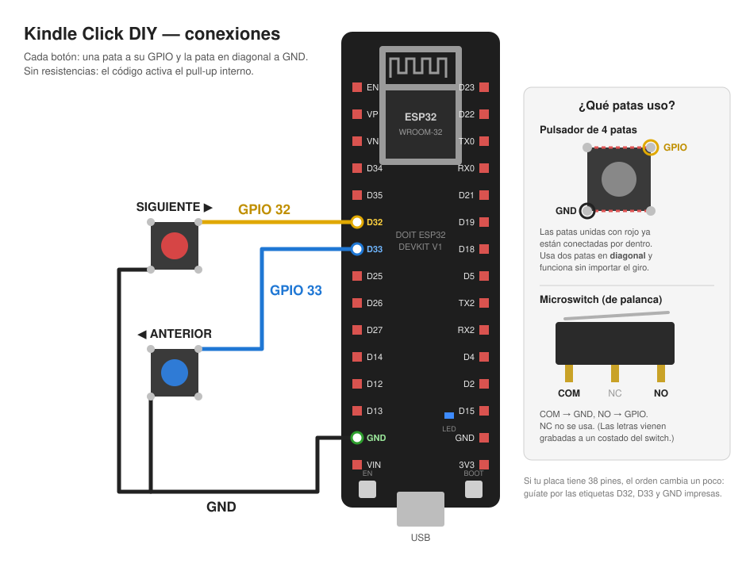

# Pasapáginas DIY compatible con Kindle

Control Bluetooth casero para pasar páginas en un Kindle, hecho con un ESP32.
Funciona como el Kindle Click oficial: el ESP32 se presenta como un teclado
BLE y envía **Page Down** (siguiente página) o **Page Up** (página anterior).

> Proyecto independiente y sin fines de lucro, sin relación con Amazon.
> Kindle es una marca registrada de Amazon.com, Inc.

## Cómo funciona

El Kindle Click es un teclado BLE (HID over GATT) de pocas teclas. Al
escanear, el Kindle solo muestra los dispositivos cuyo anuncio BLE trae el
*manufacturer data* del Click (VID `0x0171`, PID `0x0443`). El ESP32 anuncia
esos mismos valores, también en el servicio *Device Information*.

Requiere un Kindle de 2024 o posterior con firmware 5.20.1.0.2 o más nuevo.
No requiere jailbreak.

## Material

- ESP32 DOIT DevKit V1
- 2 botones (switch de pulsador)
- Protoboard y cables
- Cable USB

## Conexiones

Cada botón va entre un GPIO y GND. No hacen falta resistencias: el código
activa el pull-up interno.

El LED azul de la placa (GPIO 2) parpadea mientras espera al Kindle y se
queda fijo cuando ya está emparejado.

| Botón       | GPIO | Tecla HID         |
|-------------|------|-------------------|
| Siguiente   | 32   | Page Down (`0x4E`) |
| Anterior    | 33   | Page Up (`0x4B`)   |

## Cargar el firmware (Arduino IDE)

1. Abre el **Gestor de librerías** e instala **NimBLE-Arduino** (de h2zero),
   versión **2.x**.
2. En el menú de placas elige **DOIT ESP32 DEVKIT V1**.
3. Abre `kindle_click_diy/kindle_click_diy.ino`, selecciona el puerto y súbelo.
4. Abre el Monitor Serie a **115200** baudios para ver los mensajes.

## Emparejar con el Kindle

1. Enciende el ESP32. El LED parpadea.
2. En el Kindle, ve a Configuración → Wi-Fi y Bluetooth → Dispositivos
   Bluetooth y busca dispositivos.
3. Selecciona **Kindle Click**. No pide código.
4. Cuando el LED se quede fijo, abre un libro y prueba los botones.

## Si no funciona

- **El Kindle no lo detecta:** si el ESP32 está conectado a otro dispositivo
  (por ejemplo, un celular), deja de anunciarse. Olvídalo o apaga el
  Bluetooth de ese dispositivo. Revisa también la versión de firmware del
  Kindle.
- **Para reintentar desde cero:** olvida el dispositivo en el Kindle y borra
  el emparejamiento guardado en el ESP32. Para eso, en el Arduino IDE ve a
  *Herramientas → Erase All Flash Before Sketch Upload → Enabled* y vuelve a
  subir el código.
- **El Monitor Serie muestra "Botón GPIO ..." pero no cambia de página:** el
  Kindle está conectado pero no acepta las teclas. Abre un issue con lo que
  salga en el Monitor Serie y la versión del Kindle.

## Ideas para la siguiente versión

- Batería LiPo con deep sleep.
- Brillo y suspensión (el Click oficial también los tiene).
- Jacks de 3.5 mm para switches adaptados de accesibilidad.
- Una caja impresa en 3D.

## Créditos

- [kindlemodding.org](https://kindlemodding.org/kindle-hacking/pageturner.html):
  ingeniería inversa del Kindle Click.
- [LHBosssss/esp32-ble-page-turner](https://github.com/LHBosssss/esp32-ble-page-turner)
  y [patricksuo/zectrix-note4-esp32-kindle-page-turner](https://github.com/patricksuo/zectrix-note4-esp32-kindle-page-turner):
  formato del anuncio BLE que acepta el Kindle.

## Licencia

[MIT](LICENSE)
